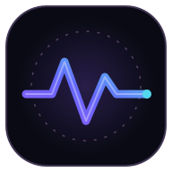

  
  <h1>V E X A U R A</h1>
  
<strong>Feel every frequency. Explore every layer.</strong>

  
A new Android audio experience, designed to go beyond the ordinary player.

  

    
    
    
    
  

---

## A different kind of audio space

**Vexaura** is an evolving Android music application with one ambition: combine a powerful listening experience, precise audio control and an optional, carefully permissioned system-integration layer.

The foundation is in place. Our distinctive experience is what we build next.

### The direction

| Experience | Vision |
| :-- | :-- |
| **Immersive playback** | Beautiful music-first navigation and a richer now-playing experience. |
| **Advanced audio** | Flexible playback behavior, audio routing and customization. |
| **Extensible architecture** | Clean boundaries between the player, UI, plugins and privileged services. |
| **Power-user tools** | Optional system-aware diagnostics and device integrations. |
| **Visual identity** | Dark-first, focused, precise and unmistakably Vexaura. |

## Beyond the sandbox

The future architecture distinguishes three Android execution contexts. These are separate privilege levels, not interchangeable app permissions.

| Context | Android UID | Future integration |
| :-- | :-- | :-- |
| **Superuser** | **0** | User-authorized root services, narrowly scoped and mediated through a privileged bridge. |
| **Shell** | **2000** | User-authorized shell integrations and diagnostics through supported interfaces. |
| **System** | **1000** | Capabilities exposed by a legitimately privileged system component, where the platform allows it. |

**Planned, not implemented:** No Vexaura-specific UID 0/2000/1000 bridge has been completed or verified. A normal app cannot simply assume UID 1000. Everyday playback should remain available without elevated permissions.

## Vexaura visual profiles

A first Vexaura-specific UI milestone is now in development:

- **Settings → Styles** with in-app previews and confirmation before applying a profile.
- **Standard** retains the original dark-first interface.
- **Veyra OLED Lila** and **Veyra OLED Lila Red** introduce tailored true-black palettes.
- **Veyra Cloud OLED Purple** and **Veyra Cloud Red Purple OLED** add relaxed, continuously drifting ambient lighting, respecting reduced-motion preferences.
- Liquid Glass is enabled by default on supported fresh installations.
- Search shares the **same floating glass island** as the other navigation tabs, including in compact mode.

These are UI changes, not a release announcement. Android build validation is performed separately; the package identity and optional system integrations remain future work.

## System & Root · v0.2.0

Advanced controls are part of the same Android/Compose settings experience: no detached admin dashboard, no strange secondary design language.

| Area | What's included |
| :-- | :-- |
| **Superuser check** | A genuine UID-0 check through the installed SU manager, with denial/timeout detection. |
| **Xposed / LSPosed** | A real in-process module-active signal, and an optional Samsung media Now Bar hook. |
| **Sound Settings** | Separate BassBoost strength and session loudness-gain sliders, applied by the playback service. |
| **Audio quality** | Connected to existing Wi-Fi/cellular source quality, 16-bit/float output and bit-perfect modes. |
| **Widgets** | Direct launcher requests for the existing Compact, Wide and Capsule player widgets. |
| **Samsung Now Bar** | Optional media capsule tint profiles with explicit Xposed scopes and hook verification. |

**Permission-aware by design:** A root-manager install does not count as a granted superuser identity. Xposed module scope does not count as an actual live SystemUI hook. The app reports each independently and leaves unsupported Samsung controls disabled on other devices.

**Audio limits:** BassBoost and LoudnessEnhancer are Android audio-session effects, not an equalizer and not a promise of overriding physical volume limits. Neither effect writes to system partitions or applies to other apps. They are bypassed during bit-perfect playback.

For exact scope names, security constraints, troubleshooting and architecture, see [System & Root technical notes](docs/SYSTEM_ROOT.md).

### Releases

Every Vexaura milestone is published through [GitHub Releases](https://github.com/ctrl-mietze/Vexaura/releases) with an APK and release notes. This repository remains a **standalone project, not a GitHub fork**.

## Development status

> **Early development.** Styles and the first System & Root features are being built. Features backed by private OEM hooks remain experimental until verified on compatible devices.

### Roadmap

1. Establish a standalone package identity, preserving the original source packages internally.
2. Keep optional root, shell and system integrations separate from the playback service.
3. Introduce capability-based, consent-driven shell/root bridges.
4. Design system integrations around genuine Android security boundaries.
5. Test, document and release the first Vexaura build.

## Build

This is an Android/Gradle codebase. Install Android Studio, a compatible JDK and SDK, then use the included Gradle wrapper.

    git clone https://github.com/ctrl-mietze/Vexaura.git
    cd Vexaura
    ./gradlew :app:assembleDebug

On Windows use **gradlew.bat :app:assembleDebug**. Release builds are tested for each milestone. Device-specific root, Xposed and OEM hooks still require verification on the actual target device.

## Development principles

**Device choice. Explicit permission. Real functionality.**

Elevated operations must be optional, inspectable and reversible. The player should not require root just to play music. See [CONTRIBUTING.md](CONTRIBUTING.md) for contribution guidelines and [SECURITY.md](SECURITY.md) for security notes.

---

  <strong>V E X A U R A</strong>
  
More than a player. A platform for what comes next.

  GPL-3.0 licensed. Copyright and source notices are preserved in the source and legal directory.

